<!-- ───────────────────────── HEADER ───────────────────────── -->

At Tradeify I build agents and agentic workflows, and I code agentically: most of what I ship is written with Claude Code running the loop. The real work is the harness around the model (tools, memory, evals, retries), so an agent holds up when nobody's watching it. Outside work, I'm building MPTL, a tamper-evident ledger that records where every agent memory came from.

  
  
  
  

  <picture>
    <source media="(prefers-color-scheme: dark)" srcset="https://raw.githubusercontent.com/yashbahirat/yashbahirat/output/contributions-dark.svg" />
    <source media="(prefers-color-scheme: light)" srcset="https://raw.githubusercontent.com/yashbahirat/yashbahirat/output/contributions.svg" />
    
  </picture>

<picture>
  <source media="(prefers-color-scheme: dark)" srcset="https://raw.githubusercontent.com/yashbahirat/yashbahirat/output/github-snake-dark.svg" />
  <source media="(prefers-color-scheme: light)" srcset="https://raw.githubusercontent.com/yashbahirat/yashbahirat/output/github-snake.svg" />
  
</picture>

  
  

